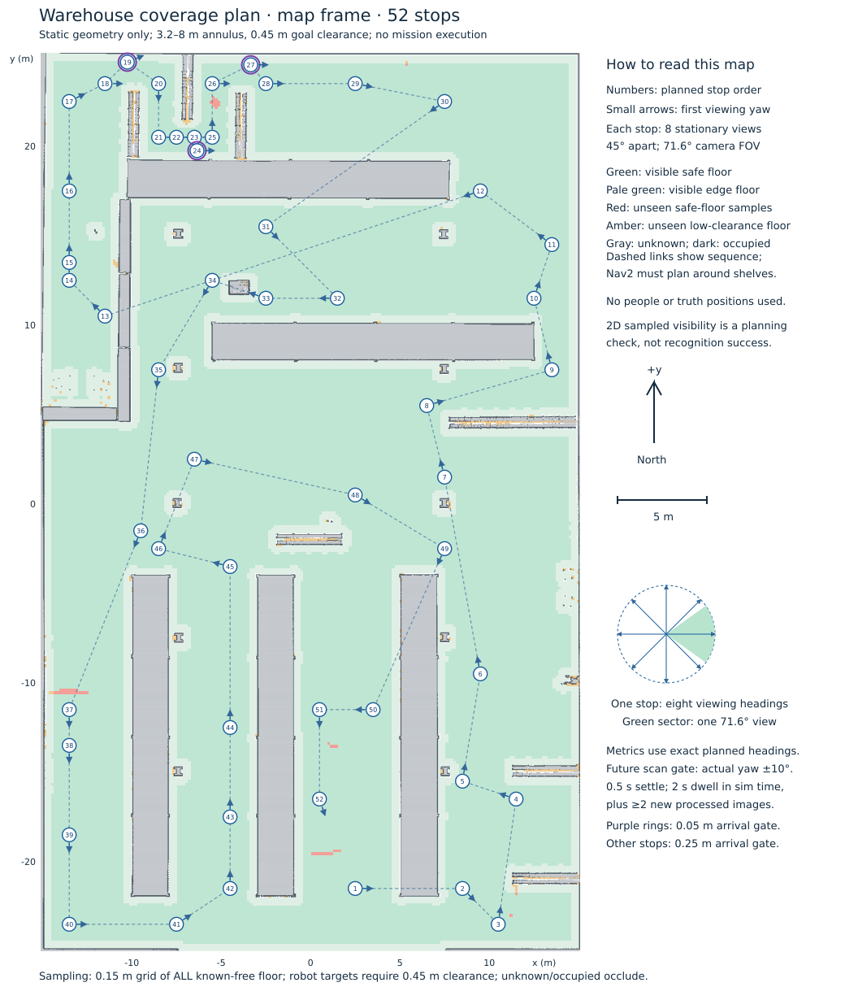

# Warehouse coverage plan

The final milestone 3 plan has **52 hardcoded C++ stops**, with a **3.2–8 m
camera-to-target planning annulus** and eight stationary viewing headings per
stop. These are planning data in
[coverage_plan.hpp](../search/include/search/coverage_plan.hpp) and the
[waypoint CSV](assets/coverage-waypoints.csv). The perception
executable still sends no navigation goals; autonomous visits, scan completion
and return home belong to milestone 4. The plan has measured, disclosed
remaining reachable coverage gaps and does not certify complete warehouse coverage.



The [standalone SVG](assets/coverage-plan.svg) preserves the annotated map,
order, first viewing directions, FOV inset, scale, map coordinates and north.
Dashed links show sequence; Nav2 must plan the actual paths around shelves.

## Map and reachable floor

The course launch defaults to
`/opt/ros/jazzy/share/nav2_bringup/maps/warehouse.yaml` and its `warehouse.pgm`.
The image is 1006 × 1674 cells at 0.03 m/cell, origin `(-15.1,-25,0)`:
map extents are x = -15.10 to 15.08 m and y = -25.00 to 25.22 m.
Person truth, reported tracks and validation placements were not inputs to
viewpoint generation. The launch's nominal robot start `(2.12,-21.3)` only
selects the connected floor component and route-order seed; it is not a
hardcoded mission return pose.

The trinary map contains 1280.063 m² known free, 27.856 m² occupied and
207.721 m² unknown cells. Unknown includes shelf interiors and unobserved
border patches; it is never treated as traversable or transparent. The three
long south shelf blocks are approximately x = `[-10,-7.9]`, `[-3,-0.9]`,
`[5,7.1]`, y = `[-22,-4]`. Northern transverse shelves occupy approximately
x = `[-10.3,7.8]`, y = `[17.1,19.2]` and x = `[-5.5,12.5]`, y = `[8,10.1]`.
Small racks, pillars and the west shelf wall also block views.

Nav2 is configured with robot radius 0.22 m and inflation radius 0.70 m.
Robot-center targets require **0.45 m clearance** from occupied/unknown cells
and the map boundary. An exact Euclidean distance transform subtracts the
blocked-cell half diagonal, then also subtracts a stored pose's displacement
from its cell center, so goal clearance is conservative for the exact x/y.
Four-connected flood fill leaves 1041.224 m² connected to the nominal start;
only 0.006 m² of otherwise clear floor is disconnected. The connected
component spans x = -14.545 to 14.585 m, y = -24.535 to 24.755 m.

Known-free floor outside that cleared component totals approximately
**238.84 m²**. People can stand near walls and shelves where the robot center
cannot go. It is included in the person-target visibility check below, rather
than silently discarded. Some such samples are isolated map flecks or narrow
rack gaps and may not be realistic standing places; all known-free samples
are retained to make that limitation visible.

## Route choice and scans

The plan visits all four aisles around the three southern shelves, the south
end cross aisle, the center cross aisle, both sides of the northern transverse
shelves, the west outer passage and the north edge passage. A view across a
shelf is never credited through its occupied/unknown footprint. Short racks,
pillars and the near blind zone require offset, overlapping viewpoints.

The initial 49-stop route used a 1 m candidate lattice with at least 0.70 m
mapped goal clearance. The offline C++ tool greedily added the viewpoint
seeing the most still-unseen **known-free** target samples. Selection used
0.30 m samples; the frozen route is evaluated at 0.15 m below. Shortest
four-connected clearance-grid distances around shelves guided nearest-neighbor
ordering and segment reversal. This is a reproducible heuristic, not an
optimal-route claim.

A bounded refinement sampled northern rack-tip candidates every 0.15 m with
at least 0.45 m clearance. Three added viewpoints look around rack ends and
recover 194 safe-floor samples (4.365 m²) and 260 all-known-free samples
(5.850 m²). Their incoming Nav2 paths were verified to end exactly at the
requested x/y before they entered the plan. Original 49 positions and first
headings were retained; the three additions use the explicitly checked phases.

| Final stop | Map x,y (m) | First heading | Conservative goal clearance | Required actual xy gate |
| --- | --- | ---: | ---: | ---: |
| 19 | -10.25, 24.70 | π/8 rad | 0.451716 m | 0.05 m |
| 24 | -6.35, 19.75 | 0 rad | 0.511716 m | 0.05 m |
| 27 | -3.35, 24.55 | 0 rad | 0.571716 m | 0.05 m |

All **52 goals** are connected and clear in the static map. The original
49 goals have at least approximately 0.743 m conservative clearance; the three
exceptions above remain above the 0.45 m planning requirement. The minimum
across the final route is approximately **0.451716 m**. Purple rings identify
the tighter viewpoints on the map. These are exact planned positions, not
observations of achieved robot pose.

Each stop has eight views, **45° apart** relative to its stored first heading.
The measured horizontal FOV is 1.25 rad = 71.62°, leaving 26.62° adjacent-view
overlap. The map metrics use **exact planned headings**, not observed Spin or
GoToPose controller behavior. For future mission credit, the actual map-frame base_link yaw
must be within **10°** of the intended heading and the robot must be stopped
and settled; otherwise correct the heading or record a missed view. The
nominal overlap allows approximately 13.31° independent heading error before
an angular gap; the 10° gate retains margin for the 0.0596 m camera offset at
3.2 m (approximately 1.07°). Nav2's configured 0.25 rad yaw goal tolerance alone
is too loose for this scan-credit policy.

Before scan credit, future mission logic must also verify actual map x/y
against each waypoint's C++ `position_tolerance_m`: **0.25 m** for the original
49 stops, **0.05 m** for stops 19, 24 and 27. This is a separate arrival-credit
gate even if Nav2 reports `SUCCEEDED`; it does not globally tighten Nav2's
controller goal tolerance. Correct a miss or record the uncovered view. The
AMCL/localization condition below remains mandatory, and nominal map visibility
does not prove execution within either tolerance.

After rotation, allow **0.5 simulated seconds settling**, then at least
**2.0 simulated seconds stationary dwell**. The optimized live detector
produced 2 Hz in simulated time (about 1.5 Hz wall time); independent image
arrival age was approximately 0.31 s median, 0.37 s maximum. Two images can
require up to 1 s cap phase plus arrival latency, leaving margin in 2 s.
Completion also requires **at least two distinct processed source images**
captured after settling at the intended view. Their image-time heading must
satisfy the gate; delayed frames from transit or the previous heading cannot
complete the view. Future mission logic must keep perception callbacks active
and report timeout/missed-view cases. These are planned requirements, not
implemented mission behavior.

## Range assumptions

[Detector measurements](detector-range.md) support a conservative 8 m maximum:
three controlled-pose side trials at camera ranges 8.741, 8.674 and 8.599 m each
passed 10/10 recognition and actual map-position checks, with horizontal errors
approximately 0.150, 0.162 and 0.141 m. Side trials at 11.335 and 13.940 m failed
recognition, despite a frontal 19.961 m trial passing. Thus frontal reach is not
used as the all-aspect planning range. These finite trials are conditional
evidence, not a guarantee for new people, poses, lighting or partial occlusion.

The **3.2 m minimum** is a separate planning constraint. The first validated
full-body frontal trial at approximately 3.142 m passed 10/10; rounding the
near cutoff up to 3.2 m avoids crediting untested closer distances. A frontal
trial at actual camera range 2.058 m produced **0/10 person boxes**, so 2 m is
not credited. Near vertical framing may matter, but this observation alone
does not isolate the cause of the miss. The sensor's 0.3 m depth clip does not
establish usable person range. Overlapping stops must view a nearby target
from farther away. The calculation uses horizontal camera-to-target distance
and additionally enforces optical-axis depth ≥0.3 m. The 8 m maximum is a
conservative radial cap, rather than allowing longer edge-of-FOV rays merely
because optical depth is smaller.

## Measured map visibility and remaining gaps

The frozen-route check samples **all known-free floor** at 0.15 m spacing.
For each target it uses all eight exact planned headings, the measured camera
offset `(-0.0596,0)` relative to the base, the 3.2–8 m annulus and actual camera
sectors. Supercover traversal at the original 0.03 m map resolution blocks rays
that touch occupied or unknown cells, including exact grid-boundary rays.
Target visibility is a 2D map calculation, not a detector or mission result.

| Target set | Visible / sampled | Visibility | Sampled gap area |
| --- | ---: | ---: | ---: |
| All known-free floor | 56,528 / 56,912 | 99.325% | 8.640 m² |
| Reachable floor with ≥0.45 m clearance | 46,178 / 46,231 | 99.885% | 1.193 m² |
| Remaining known-free edge/disconnected floor | 10,350 / 10,681 | 96.901% | 7.448 m² |

The [comparison CSV](assets/coverage-comparison.csv) preserves the exploratory
3–8 m / 45-stop plan and the 3.2–8 m / 49-stop baseline. The latter had 98.868%
all-known-free and 99.466% safe-floor visibility, with 14.490 m² and 5.558 m²
sampled gaps respectively. The final three additions reduce those gaps to the
values above without crediting failed closer-range detection.

Areas estimate missed samples × 0.15² m², rather than an exact continuous-area
proof. Green in the map marks visible safe-floor samples, pale green visible
edge samples, red missed safe-floor samples and amber missed edge samples.
Unknown 207.721 m² and occupied 27.856 m² are explicitly excluded from both
known-free visibility denominators and remain opaque.

The largest connected clusters of missed samples are:

| Map x interval (m) | Map y interval (m) | Approximate gap | Interpretation |
| --- | --- | ---: | --- |
| 8.075 to 14.825 | 4.295 to 4.595 | 1.260 m² | Edge-floor strip beside the east lateral rack; remains unseen even without the near cutoff. |
| -10.075 to -9.625 | 20.195 to 23.045 | 0.608 m² | Low-clearance northern rack edge; four of 27 samples are near-cutoff limited. |
| -7.075 to -6.775 | 21.245 to 23.795 | 0.540 m² | Low-clearance northern rack edge; seven of 24 samples are near-cutoff limited. |
| 11.975 to 14.975 | -14.905 to -14.605 | 0.518 m² | Edge-floor strip at an east rack; remains unseen even without the near cutoff. |
| -14.575 to -12.475 | -10.555 to -10.405 | 0.495 m² | West aisle strip; includes 0.450 m² safe floor, all 22 samples near-cutoff limited. |
| -4.075 to -3.775 | 20.345 to 22.895 | 0.473 m² | Low-clearance northern rack edge; three of 21 samples are near-cutoff limited. |

The original northern pocket's reachable safe gap falls from 209 samples
(4.703 m²) to 15 samples (0.338 m²), split into smaller fragments. Remaining
safe-floor patches also include 0.248 m² near x = 0.125 to 1.625 m,
y = -19.555 to -19.405 m, and the west aisle strip above.

Across the final route, 103 of 384 missed samples (approximately 2.318 m²)
would be visible only if the chosen near cutoff were ignored. All remaining
53 safe-floor missed samples are near-cutoff limited for this route. The other
misses remain unseen from these stops even without that cutoff. This does not
prove the gaps unavoidable for every route. The failed 2 m trial earns no
near-range credit; remaining reachable gaps stay visible and **full coverage
acceptance remains unproven**. No further viewpoint additions are implied by
this bounded refinement.

The 2D map cannot establish visibility of an entire person at camera height.
Body size, aspect, vertical cropping, partial shelf occlusion and detector
confidence can reduce recognition. A stationary full scan changes camera
heading, but does not change the person's body aspect from the same viewpoint.
Unknown placements and partial occlusions still require milestone 5 testing.

## Localization condition

Detector reach is conditional on accurate robot localization. An earlier live
side-view trial at approximately 8.74 m recognized the person in 10/10 images,
but all 10 usable-position checks failed: image-time TF estimates had about
0.590 m horizontal error while upstream AMCL was offset by about 0.488 m.
Reprojecting the same pixel/depth with the native Gazebo robot pose gave about
0.139 m error. Subsequent no-motion updates did not fix the drift. See
[detector-range.md](detector-range.md) for the retained failed run and explicitly
labelled validation-only pose initialization used in controlled range trials.
Production perception continues to use image-time TF; no Gazebo truth enters
this coverage plan or the search algorithm. Milestone 4 must address observed
localization drift/readiness, and final mission accuracy remains unverified.

## Reproduce and verify

The C++ tool is offline: no ROS subscriptions, goals or simulator changes.
It reads this course map's fixed resolution, origin and trinary thresholds;
a replacement map requires updating those constants.

```bash
# From the repository; no ROS launch or workspace build needed.
g++ -std=c++17 -O2 -Wall -Wextra -Wpedantic -Isearch/include \
  search/test/coverage_map.cpp -o /tmp/coverage_map
/tmp/coverage_map /opt/ros/jazzy/share/nav2_bringup/maps/warehouse.pgm \
  8 --check docs/assets/coverage-plan.svg 5
# Stride 5 map cells = 0.15 m. --check evaluates the hardcoded final route.
# --generate proposes a route; it does not modify the header or move the robot.
```

Seven standalone C++ tests cover angular overlap/wrap and the allowed heading
error, route/position-gate integrity, range versus occlusion, unknown/corner rejection,
clearance erosion, exact-boundary supercover and the person-range annulus
independent of sensor depth clipping. Synthetic maps contain no person data.
The map tool checks the final goals' static clearance/connectivity. Neither
that check nor a read-only Nav2 path result proves a completed transit, scan,
recognition or return-home mission.

## Read-only Nav2 path verification

### Baseline 49-stop result

After restoring the validation person, the previous installed route checker
requested `/compute_path_to_pose` for all **49 baseline legs**, starting from
the course launch's map pose `(2.12,-21.3,1.57)`. Every request explicitly used
a hypothetical start at the preceding waypoint. It sent no NavigateToPose,
Spin or velocity commands and did not move/teleport the robot.

All **49/49** returned `SUCCEEDED`, error code 0 and nonempty paths. Their sum
was **283.373 m**; longest leg **39.673 m**; summed planning wall time **5.706 s**.
This baseline check did not enforce the later 0.10 m path-endpoint criterion.
See [baseline per-leg results](data/coverage-path-checks-baseline49.csv) and
`setup-logs/milestone3/nav2-coverage-paths-baseline49.jsonl`. Native Gazebo poses
before/after showed 0.0 m robot xy displacement. These numbers describe the
49-stop baseline, not the final 52-stop route.

### Three added viewpoint checks

A temporary C++ client requested only ComputePathToPose, on simulated time,
with `use_start=true` from the corresponding original neighboring stops:

| Added stop | Explicit map start x,y (m) | Goal x,y (m) | Computed length | Final path xy error |
| --- | --- | --- | ---: | ---: |
| 19 | -11.5, 23.5 | -10.25, 24.70 | 1.770553 m | 0.000 m |
| 24 | -6.5, 20.5 | -6.35, 19.75 | 0.790493 m | 0.000 m |
| 27 | -5.5, 23.5 | -3.35, 24.55 | 2.446928 m | 0.000 m |

All three returned `SUCCEEDED`, error code 0, nonempty paths and endpoint error
≤0.10 m before the plan was changed. Raw proof is in
`setup-logs/milestone3/candidate-nav2-paths.jsonl`. The final returned positions
were recorded explicitly; success alone was not treated as exact arrival.
These requests did not send motion goals. The tighter 0.05 m field is a future
**actual robot** scan-credit requirement; a computed endpoint is not execution.

### Final 52-stop route

The updated installed checker verified **all 52/52 final legs** successfully,
with error code 0, nonempty paths and **0.000 m endpoint xy error** for every
goal. It enforced at most 0.10 m endpoint error for ordinary goals and the
stricter 0.05 m field for tight views 19, 24 and 27. This is the final route
result, separate from the earlier baseline and isolated-candidate requests.
Reproduce using:

```bash
source scripts/ros-env.bash
ros2 run search check_coverage_paths --ros-args -p use_sim_time:=true \
  -p start_x:=2.12 -p start_y:=-21.3 -p start_yaw:=1.57 \
  -p output_path:=/tmp/nav2-coverage-paths52.jsonl
```

The final computed paths sum to **285.941 m**, excluding return home; the
longest leg is **39.673 m**. Summed request-processing wall time was **2.837 s**.
The [final per-leg CSV](data/coverage-path-checks.csv) records requested poses,
arrival-credit tolerances, path sizes/lengths and endpoint errors. Raw results
are `setup-logs/milestone3/nav2-coverage-paths-final.jsonl` and
`nav2-coverage-path-summary-final.json`. No motion goals were sent.

Planning checks do not establish execution, dynamic-obstacle avoidance,
achieved pose/heading or recognition. The final scan budget alone is
52 × 8 × (0.5 + 2.0) = **1040 simulated seconds**, before travel, rotation,
retries and return home. Actual mission duration remains unmeasured; milestone
4 should assess that cost and any simplification without hiding coverage gaps.
